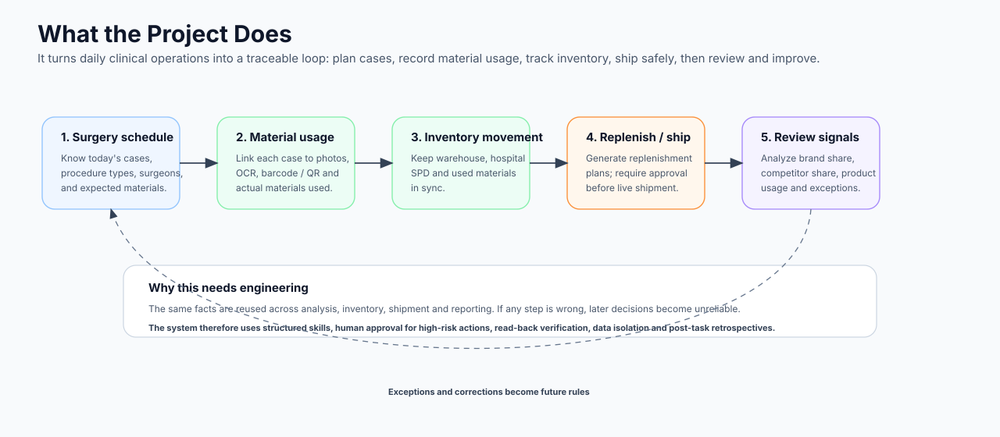
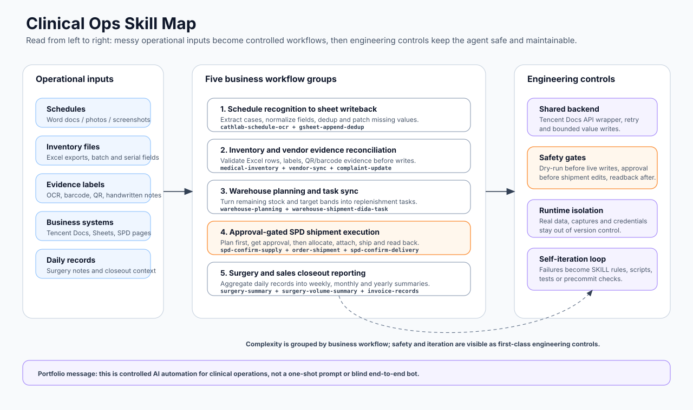
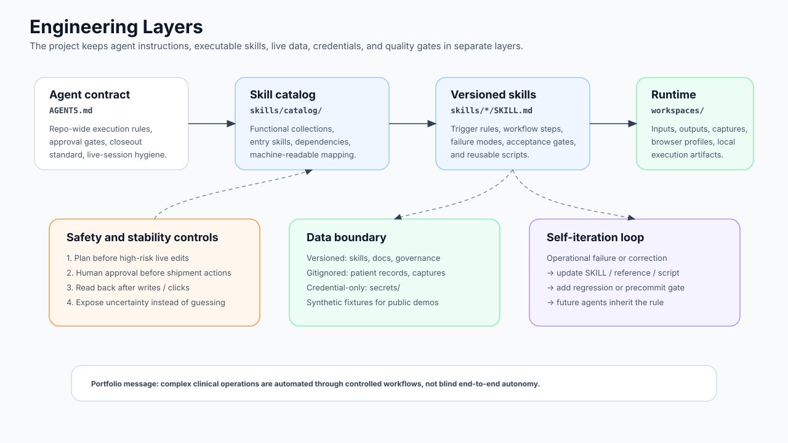
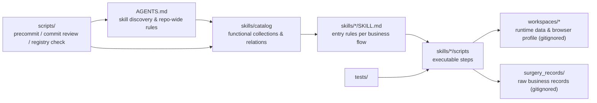

# Clinical Ops Skill Kit

English | [中文](README.zh-CN.md)

A **skill-based AI automation kit** for clinical / medical sales operations at a tertiary hospital cardiology department. It turns repeated human work — schedule OCR, inventory sync across SaaS docs, warehouse shipment planning, business-system clicks, surgery summaries — into versioned, reusable **skills** that an LLM agent can dispatch.

> This is a **desensitized public showcase** of an in-production private repository (8+ months of iteration, 560+ commits). Hospital names, patient data, vendor names and credentials are stripped. The architecture, design rules and key skills are kept intact. Full source can be granted on request for interviews.

---

## Plain-language version

This project is not about writing a few automation scripts. It connects the daily records behind clinical medical-device operations, where small misses can break later analysis.

### Business logic map

| Business question | Why it matters | Automation capability |
| --- | --- | --- |
| Which surgeries are scheduled today? | The surgery schedule is the foundation for later analysis. Once dates, procedure types, surgeons and cases are structured, the operator can analyze procedure mix and the share between one brand and competing products. | Schedule OCR, field structuring, Google Sheet writeback |
| Which materials were used in each case? | On-site usage cannot rely on memory or scattered screenshots. Photos, OCR, barcode / QR evidence, inventory tables and surgery records need to become a traceable per-case material record. | Case OCR, barcode / QR cross-check, inventory matching |
| How did inventory change, and where is it now? | Materials move between warehouse, hospital SPD and case usage. Inaccurate inventory affects replenishment, shipment and later charge checks. | Excel conversion, Tencent Docs inventory sync, arrival-status update |
| What should be replenished or shipped? | Replenishment depends on surgery pace, target stock bands, remaining inventory and confirmed shipments, not just a simple total count. | Warehouse replenishment planning, task sync, SPD shipment plan |
| Which actions are high risk? | SPD shipment, inventory status changes and live sheet writes affect real operations. The agent must not silently click or write. | Dry-run / live split, human approval gate, read-back verification |
| How do we review performance later? | Once schedule, material usage, inventory movement and sales records connect, the operator can review brand/competitor share, surgery rhythm, product usage changes, complaints and weekly/monthly summaries. | Surgery statistics, sales summary, exception log, closeout retrospective |

The operational chain is:

```text
surgery schedule
  -> expected cases and procedure types
  -> on-site material usage
  -> inventory movement
  -> replenishment / shipment plan
  -> sales and procedure-share analysis
  -> exception review becomes future rules
```

In short: **this is an AI-assisted operations loop connecting surgery schedules, material usage, inventory movement, replenishment, shipment, sales reporting and exception review.**



## What this repo is for

- Show the **architecture** of a skill-based agent kit for a narrow domain (medical sales ops).
- Show the **separation of concerns**: capability layer (`skills/`), runtime layer (`workspaces/`), credential layer (`secrets/`), governance layer (`scripts/`).
- Show **how to keep an agent honest** in a high-risk domain: dual closeout, approval gates, validation rules, runtime data isolation.

## What this repo is **not** for

- Not a generic agent framework. The skills here are specific to clinical sales ops.
- Not a drop-in deploy. Credentials, real schedules, real inventory and patient records are not in this repository — by design.
- Not a substitute for each skill's own `SKILL.md`. The README is the map; the skills are the territory.

---

## Portfolio view

The core design point is **controlled automation in a complex domain**: skills coordinate multi-system clinical operations, while safety gates, runtime isolation and retrospectives keep the agent from silently guessing or writing into live systems.





## Architecture at a glance



Four layers, deliberately kept apart:

| Layer | Path | Holds |
| --- | --- | --- |
| Capability | `skills/` | `SKILL.md`, `scripts/`, `references/`, `agents/` |
| Catalog | `skills/catalog/` | functional collections, upstream/downstream relations |
| Runtime | `workspaces/` | inputs, outputs, captures, browser profiles (gitignored) |
| Credential | `secrets/` | per-task local credentials (gitignored) |
| Governance | `scripts/` | precommit, hook install, commit review, registry sync |
| Tests | `tests/` | regression for skill scripts and governance |
| Raw records | `surgery_records/` | business markdown records (gitignored) |

## Current skill map (15 skills, 9 functional collections)

- **Cathlab schedule recognition → writeback**: `cathlab-schedule-ocr → gsheet-append-dedup`
- **Tencent Docs inventory import**: `medical-inventory-tencent-import`
- **Warehouse shipment planning & dispatch**: `warehouse-shipment-planning → warehouse-shipment-dida-task`
- **Vendor on-site sync**: `vendor-sales-inventory-sync`
- **Material complaint update**: `material-complaint-update`
- **Business system automation**: `spd-confirm-supply → order-shipment → spd-confirm-delivery`, plus `vendor-invoice-records`
- **Surgery stats**: `surgery-summary → surgery-volume-summary`
- **Cross-task governance**: `task-closeout-standards`
- **Shared backend**: `tencent-docs-api-v3` (Tencent Docs official API V3 client, reused by inventory / warehouse / complaint / vendor flows)

Full relation graph and machine-readable mapping:

- [skills/catalog/README.md](skills/catalog/README.md)
- [skills/catalog/collections.yaml](skills/catalog/collections.yaml)

## Why this design

See [WHY.md](WHY.md) — the short version: every "save a few minutes per day" automation eventually collides with **document tools that don't cooperate with AI** (Tencent Docs being the canonical example), **live business systems where one wrong click costs real money**, and **operators who need to override the agent at any step**. The split layers and approval gates exist to keep all three safe.

## Maintenance rules (lifted from the private repo)

- When adding a skill, update `AGENTS.md` and `skills/catalog/collections.yaml` in the same commit.
- When adding `skills/*/SKILL.md`, the same commit must sync: `AGENTS.md`, root `README.md`, `skills/catalog/README.md`, `skills/catalog/collections.yaml`.
- When first introducing `workspaces/<name>/`, the same commit syncs: root `README.md`, `skills/catalog/README.md`.
- Runtime data goes under `workspaces/<business>/` and is gitignored.
- Project scripts run on `./.venv/bin/python` (in the private repo); not enforced here since this is a showcase.
- Precommit: `./scripts/precommit_checks.sh`
- Doc sync gate: `./scripts/check_repo_docs_sync.py`
- Skill registry consistency gate: `./scripts/check_skill_registry.py`

## Entry points

- [AGENTS.md](AGENTS.md) — repo rules and discoverable skills
- [skills/catalog/README.md](skills/catalog/README.md) — functional collections and dependencies
- [scripts/precommit_checks.sh](scripts/precommit_checks.sh) — pre-commit checks
- [scripts/check_repo_docs_sync.py](scripts/check_repo_docs_sync.py) — doc sync gate
- [scripts/check_skill_registry.py](scripts/check_skill_registry.py) — registry consistency gate
