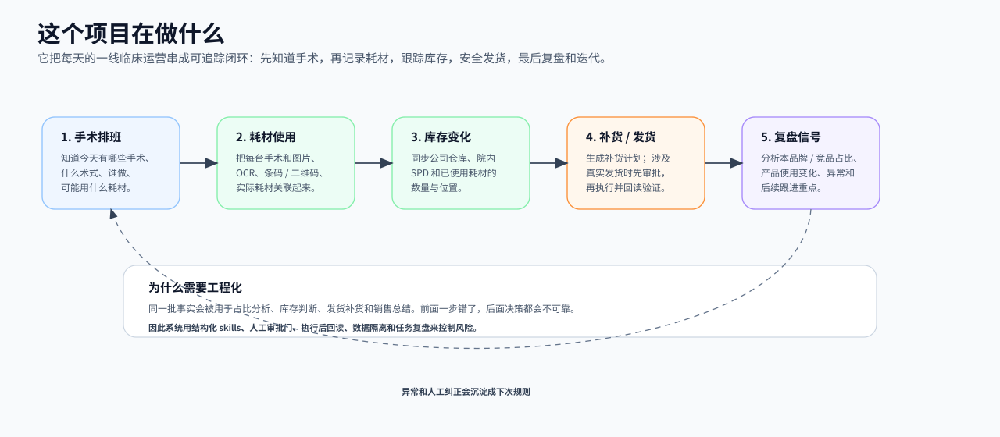
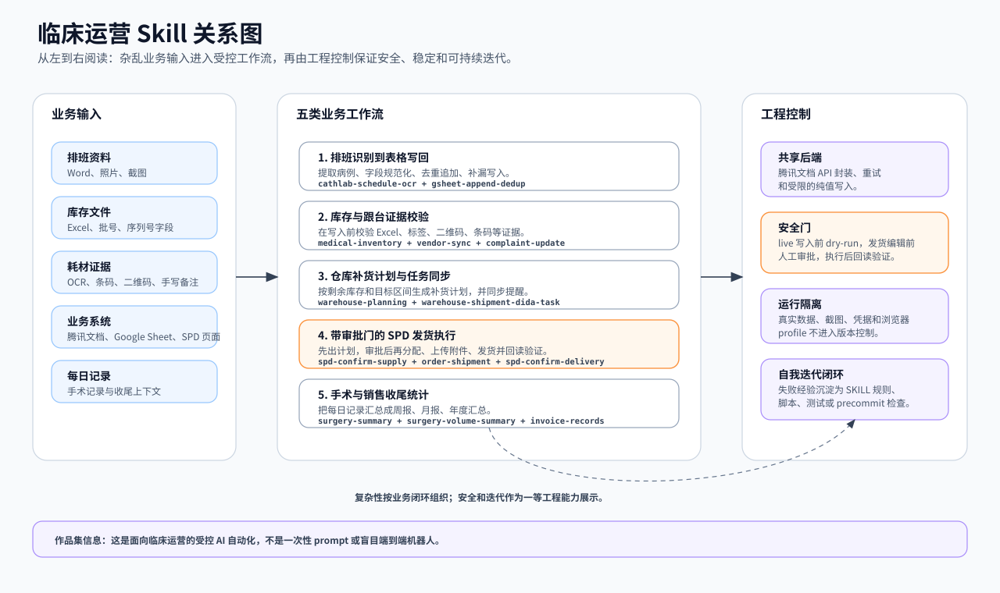
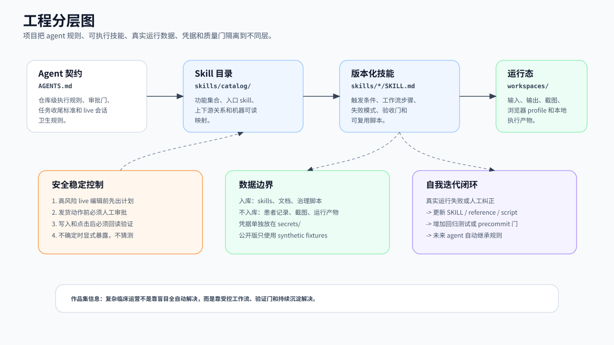
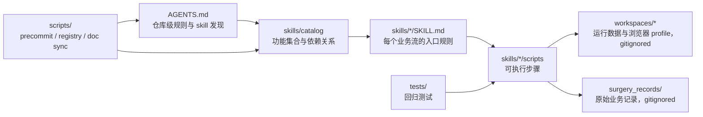

# Clinical Ops Skill Kit

[English](README.md) | 中文

一个面向临床 / 医疗器械销售运营的 **skill-based AI 自动化套件**。它把排班 OCR、表格写回、腾讯文档库存同步、仓库补货计划、SPD 发货和手术统计等重复工作，拆成 LLM agent 可以调用、可以验证、可以持续沉淀的版本化 skills。

> 这是生产私有仓库的脱敏 public showcase。真实医院名、患者信息、厂商名、凭据和运行数据均已移除；保留的是系统架构、设计规则、工程边界和关键工作流形状。

## 小白版：这个项目在做什么

这个项目解决的不是“写几个自动化脚本”，而是把一线临床运营里每天反复发生、又容易出错的记录工作串起来。

### 业务逻辑地图

| 业务问题 | 为什么重要 | 对应自动化能力 |
| --- | --- | --- |
| 今天有哪些手术？ | 排班是后续所有分析的基础。只有先知道手术日期、术式、医生和病例，后面才有办法分析本品牌与竞品在不同术式里的占比。 | 排班 OCR、字段结构化、Google Sheet 写回 |
| 每台手术用了什么耗材？ | 跟台记录不能只靠记忆或零散截图。需要把图片、条码 / 二维码、库存表和手术记录串起来，形成“某台手术用了哪些耗材”的可追踪记录。 | 跟台 OCR、条码 / 二维码交叉校验、库存匹配 |
| 库存还剩多少、在哪里？ | 手术使用、入库、院内 SPD、公司仓库之间会持续变化。库存不准会影响补货、发货和后续收费核对。 | Excel 转换、腾讯文档库存同步、到货状态更新 |
| 要不要补货、发哪些货？ | 补货不是简单看总数，还要结合手术节奏、目标库存区间、剩余库存和已确认发货。 | 仓库补货计划、滴答任务同步、SPD 发货计划 |
| 哪些动作风险高？ | SPD 发货、库存状态修改、表格写入都可能影响真实业务。不能让 AI 静默点击或误写。 | dry-run / live 分离、人工审批门、执行后回读验证 |
| 事后怎么复盘？ | 排班、耗材使用、库存变化和销售记录连起来后，才能做品牌/竞品占比、手术节奏、产品使用变化、投诉追踪和周/月总结。 | 手术统计、销售总结、异常记录、任务收尾复盘 |

按业务链条看，它大致是：

```text
手术排班
  -> 预计病例和术式
  -> 跟台耗材记录
  -> 库存变化
  -> 补货 / 发货计划
  -> 销售与手术占比分析
  -> 异常复盘并沉淀为下次规则
```

所以这个项目的核心价值是：**把手术排班、耗材使用、库存变化、发货补货、销售统计和异常复盘连成一个可验证的 AI 辅助运营闭环。**



## 这个仓库展示什么

- **复杂性**：不是单脚本，而是 15 个 skills、9 个功能集合、多系统、多输入、多阶段的临床运营工作流。
- **安全稳定**：通过人工审批门、dry-run / live 分离、写后回读、运行数据隔离，避免 AI 在高风险系统中静默误写或误点击。
- **自我迭代**：真实运行中的失败和人工纠正，会沉淀为 `SKILL.md` 规则、reference、脚本逻辑、测试或 precommit 检查。

## 这个仓库不展示什么

- 不是通用 agent 框架；这里的 skills 针对临床销售运营场景。
- 不是可直接部署的生产系统；真实凭据、真实排班、真实库存和患者记录不会进入 public repo。
- 不是每个 skill 的完整替代说明；README 是地图，具体执行规则在各个 `SKILL.md` 中。

## 作品集视图

核心设计点是：**复杂业务中的受控自动化**。AI 负责结构化、匹配、规划和收尾；高风险写入和发货动作通过审批门、回读验证和运行隔离来控制风险。





## 架构概览



| 层 | 路径 | 内容 |
| --- | --- | --- |
| 能力层 | `skills/` | `SKILL.md`、`scripts/`、`references/`、`agents/` |
| 目录层 | `skills/catalog/` | 功能集合、上下游关系、机器可读 mapping |
| 运行层 | `workspaces/` | 输入、输出、截图、浏览器 profile，默认不入库 |
| 凭据层 | `secrets/` | 本地账号和密钥，默认不入库 |
| 治理层 | `scripts/` | precommit、registry check、doc sync |
| 原始记录层 | `surgery_records/` | 原始手术记录，默认不入库 |

## 当前 skill 版图

- **排班识别到表格写回**：`cathlab-schedule-ocr → gsheet-append-dedup`
- **腾讯文档库存导入**：`medical-inventory-tencent-import`
- **仓库补货计划与任务同步**：`warehouse-shipment-planning → warehouse-shipment-dida-task`
- **跟台销售 / 库存同步**：`vendor-sales-inventory-sync`
- **耗材投诉更新**：`material-complaint-update`
- **业务系统自动化**：`spd-confirm-supply → order-shipment → spd-confirm-delivery`，以及 `vendor-invoice-records`
- **手术统计**：`surgery-summary → surgery-volume-summary`
- **跨任务治理**：`task-closeout-standards`
- **共享底座**：`tencent-docs-api-v3`

更多关系见：

- [skills/catalog/README.md](skills/catalog/README.md)
- [skills/catalog/collections.yaml](skills/catalog/collections.yaml)

## 维护入口

- [AGENTS.md](AGENTS.md)：仓库规则与可发现 skills
- [docs/architecture.md](docs/architecture.md)：工程分层解释
- [WHY.md](WHY.md)：为什么这样设计
- [docs/diagrams/README.md](docs/diagrams/README.md)：中英文图示文件
- [scripts/precommit_checks.sh](scripts/precommit_checks.sh)：提交前检查
