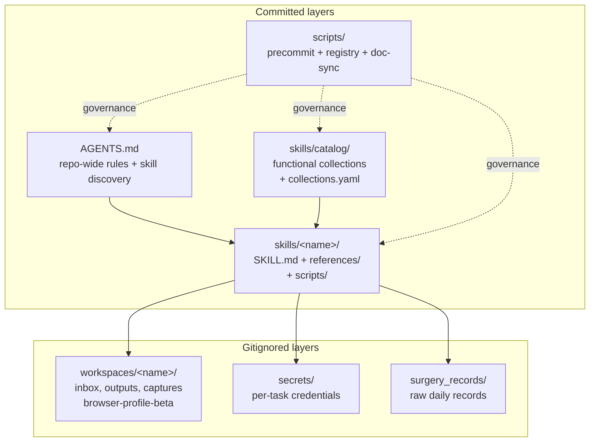

# Architecture

Four committed layers + two gitignored layers, deliberately kept apart.

## Decision: why split capability and runtime

Mixing reusable instructions with runtime data creates risks: patient identifiers,
screenshots and browser credentials can accidentally be staged. These are design
risks, not a verified account of historical incidents.

The split into `skills/` (versioned) and `workspaces/` (runtime, gitignored) makes the safe path the default path: writing to `workspaces/<name>/` is automatically out of git. The skill author has to *explicitly* reach back into `skills/` to commit anything. That asymmetry is the design.

`secrets/` got its own dedicated layer for the same reason — credentials shouldn't share a folder with screenshots that get auto-cleaned, because auto-clean might not run when it matters.

## Decision: why a `skills/catalog/`

15 skills is already too many to keep in one human's head. The catalog gives every skill:

- A **role** inside one of nine functional collections.
- A declared **upstream / downstream** relation (entry / fast_path / shared_backend / task_sync / planning_input / precondition).

This lets the agent pick the right skill instead of guessing from the user's free-form prompt, and lets the precommit hook reject any new skill that doesn't declare its place in the graph.

## Decision: why the governance scripts run on precommit, not CI

CI catches it eventually. Precommit catches it before push. For a one-operator repo with no team review, "catches it eventually" is too late — the wrong skill is already memorized into the agent's chain of habit. The precommit gate is the cheapest forcing function.

## Decision: what is the unit of authoring

One `SKILL.md` per business flow. Not one per file, not one per script, not one per concept. The unit is **"the agent should be able to read this and know what to do for the next request that triggers this skill"**.

Concretely, every `SKILL.md` has the same skeleton:

1. YAML frontmatter (`name`, `description`).
2. What this doc is for / when to use / what it doesn't cover.
3. Trigger conditions.
4. Workflow steps (numbered).
5. Mode split (read-only vs writeback, attended vs API, etc.).
6. Hard rules.
7. Guardrails / failure modes.
8. Acceptance gates.
9. Cross-skill relationships.

Sections 7–8 are where most of the real value lives — they encode "what went wrong before, why, and the rule that catches it next time". That's the part that compounds across the 8 months and 560 commits.

## What's not here (yet)

- A formal scheduler. Right now the agent dispatches skills directly from the user's chat. A cron-style trigger layer might come later, but for one operator on a phone+laptop, the chat-dispatch flow is sufficient.
- A test harness for the skill rules themselves. There are unit tests under `tests/` for governance scripts and a few business converters, but the rules in `SKILL.md` are not yet covered by golden-file regression tests. This is the most useful next investment.
- A user-facing "what changed this week" digest. Operationally tracked in `surgery_records/` and TickTick, not in the repo.
