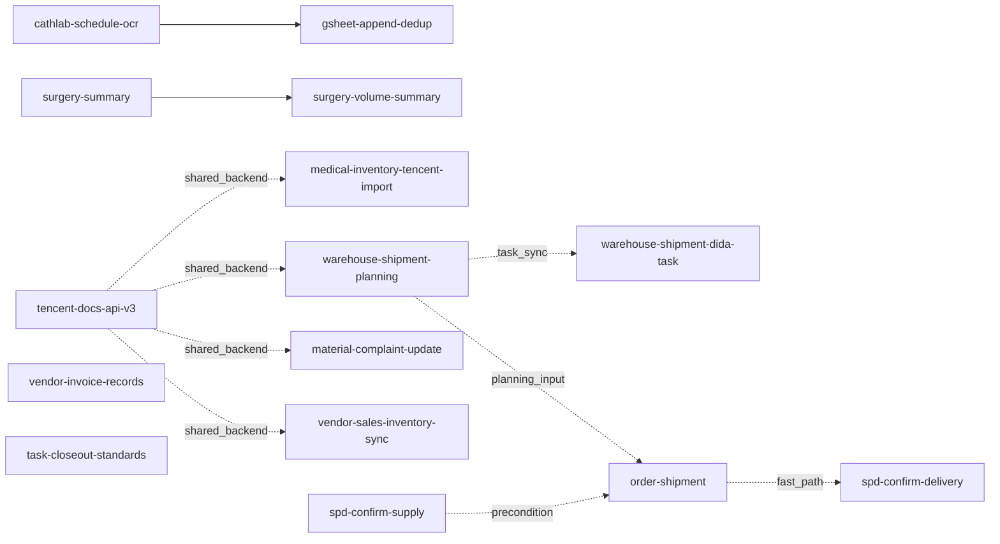

# Skills functional catalog

What this directory is for:

- Organize the repo's skills by **functional collection**
- Mark entry skills, downstream skills, and shared-backend relations
- Constrain the boundary between the skill layer and the runtime layer

When to use:

- Deciding which skill a request should land in
- Mapping the order of a multi-skill workflow
- Maintaining `AGENTS.md` or onboarding a new skill

What this directory does **not** do:

- Replace each `SKILL.md`'s execution details
- Hold runtime input / output / screenshots / temp files
- Substitute for test results or live operation logs

## Unified directory standard (important)

- `skills/` only holds skill definitions and reusable logic: `SKILL.md`, `scripts/`, `references/`, `assets/`.
- Business runtime data lives under `workspaces/<business>/`, not under `skills/`.
- `skills/workspaces/` is legacy and kept only for compatibility; new runtime data should not go there.
- Recommended runtime subdirs: `inbox/`, `history/`, `outputs/`, `sources/`, `captures/`, `temp/` (create as the business needs).

## One-line skill index

- `cathlab-schedule-ocr` — OCR cathlab schedule images / Word files into structured case records.
- `gsheet-append-dedup` — Safely write structured cases into Google Sheet, with dedup and blank-field fill.
- `medical-inventory-tencent-import` — Convert inventory Excel into Tencent Docs import order; also flip arrival status to "cath lab".
- `warehouse-shipment-dida-task` — Sync the day's finalized shipment list into TickTick task `📚Work / <hospital> shipment`.
- `warehouse-shipment-planning` — Generate replenishment plans for the upstream warehouse from empty-patient-id remainder rows.
- `material-complaint-update` — Patch complaint number / remarks into the original inventory row from complaint photos + same-day case context.
- `spd-confirm-supply` — Confirm a new purchase order in the SPD homepage to-do list, push it into `pending shipment`.
- `order-shipment` — Automate the full SPD shipment scan / allocate / attach / confirm flow.
- `spd-confirm-delivery` — Fast path: confirm shipment for a single edit-page slip.
- `vendor-invoice-records` — Collect vendor invoice records and safely write back to Excel.
- `vendor-sales-inventory-sync` — Read the day's vendor-on-site cases; OCR + barcode + QR cross-check; sync sales + inventory.
- `surgery-summary` — Aggregate daily surgery markdown records into base statistics.
- `surgery-volume-summary` — Produce weekly / monthly / yearly summary one-liners with closure validation.
- `task-closeout-standards` — Enforce a short retrospective after each task, and sediment stable rules back into the repo.
- `tencent-docs-api-v3` — Tencent Docs official API V3 client (OAuth2, batch read/write, retry) as a shared backend.

## How to read the relation graph

Humans should look at the chart below first. Agents should read `collections.yaml` for the authoritative `skills[].role` and `relations[]` — that is the machine-parseable source.

How to read:

- Solid arrows: main-flow precedence.
- Dashed arrows: shared backend, quality gate, or post-processing.
- No arrow: independent entry skill — not necessarily forever, just not declared yet.

## Collection A — Cathlab schedule recognition and writeback

- `cathlab-schedule-ocr`: OCR + rule judgment + structured output (entry).
- `gsheet-append-dedup`: Google Sheet dedup append + blank-field patch (downstream writer).

Relation: `cathlab-schedule-ocr → gsheet-append-dedup`

## Collection B — Inventory import + status flip

- `medical-inventory-tencent-import`: strict conversion of `.xls/.xlsx` to a Tencent Docs import order (rule v4) with encoding repair and integrity self-check. Also handles status flip from "company warehouse" to "cath lab" when delivered goods arrive.

Relation: independent skill, no downstream.

## Collection C — Business system process automation

- `spd-confirm-supply`: confirm new purchase order on the SPD homepage to-do.
- `order-shipment`: SPD shipment order pipeline.
- `spd-confirm-delivery`: fast path for the current edit-page slip.
- `vendor-invoice-records`: vendor invoice collection + Excel writeback.

Relations:
- `spd-confirm-supply → order-shipment` (new purchase order must be confirmed first, before it enters pending shipment).
- `order-shipment → spd-confirm-delivery` (fast path once the current slip is ready).
- `vendor-invoice-records` is independent.

## Collection D — Warehouse replenishment and pre-shipment planning

- `warehouse-shipment-planning`: read empty-patient-id remainder from formal inventory; produce a target-stock-band replenishment plan for the upstream warehouse.
- `warehouse-shipment-dida-task`: sync the day's finalized shipment list to TickTick `📚Work / <hospital> shipment`.

Relations:
- `warehouse-shipment-planning → warehouse-shipment-dida-task` (after quantities lock, sync TickTick shipment task; main-task date defaults to shipment day).
- `warehouse-shipment-planning → order-shipment` (form the plan first, then execute in the hospital SPD).

## Collection E — Vendor on-site sales / inventory sync

- `vendor-sales-inventory-sync`: from the default Google Sheet for a given day, keep only one specified vendor's atrial-fibrillation / non-AF cases; save filtered set as local JSON; OCR case-sheet images, cross-check via barcode and QR with vendor-prefixed codes; retain runtime artifacts for 7 days.

Relation: independent entry; downstream sales-table / inventory-table rules will be added once stabilized.

## Collection F — Material complaint update

- `material-complaint-update`: locate the original row in the formal Tencent Docs inventory from complaint photos and same-day case context; patch complaint number + remarks.

Relation: independent entry; Tencent Docs read/write provided by `tencent-docs-api-v3`.

## Collection G — Surgery records summary

- `surgery-summary`: aggregate markdown records under `surgery_records/` by date.
- `surgery-volume-summary`: closure-validated weekly / monthly / yearly summary one-liners.

Relation: `surgery-summary → surgery-volume-summary` (optional pipeline; former produces stats, latter produces the report sentence).

## Collection H — Cross-task closeout and doc standard

- `task-closeout-standards`: enforce short retrospective ("pitfalls / fixed-fix / next-default-path") and constrain new-document intros to declare purpose, scope, and boundary.

Relation: cross-collection generic skill, stackable on any business skill, no business-flow dependency.

## Collection I — Tencent Docs shared backend

- `tencent-docs-api-v3`: Tencent Docs official API V3 client wrapper — OAuth2, batch read/write, retry — for flows that need "read-only / pure-value-write".

Relation: shared-backend skill, not a default business entry. Currently serves `medical-inventory-tencent-import`, `warehouse-shipment-planning`, `material-complaint-update`, `vendor-sales-inventory-sync`.

## Workspace assignments

- `workspaces/cathlab-schedule-ocr/` — Cathlab schedule recognition and writeback
- `workspaces/vendor-sales-inventory-sync/` — Vendor on-site sales / inventory sync
- `workspaces/medical-inventory-tencent-import/` — Inventory import and status flip
- `workspaces/vendor-invoice/` — Vendor invoice records
- `workspaces/order-shipment/` — Business system shipment automation
- `workspaces/tencent-docs-api/` — Tencent Docs shared backend

## Maintenance rules

- When adding a skill, also list it under its functional collection here.
- When adding `skills/*/SKILL.md`, the same commit must sync: `AGENTS.md`, root `README.md`, this README, and `collections.yaml`.
- When first introducing `workspaces/<name>/`, the same commit must sync at least: root `README.md`, this README, and add the workspace assignment here.
- If one original prompt is split into multiple skills, declare entry vs downstream in the collection.
- When changing upstream/downstream relations, sync `collections.yaml`.
- Precommit: `./.venv/bin/python scripts/check_skill_registry.py` (catches drift between `AGENTS.md`, catalog and actual `SKILL.md` files).
- Precommit: `./.venv/bin/python scripts/check_repo_docs_sync.py` (catches new skill / workspace that bypassed docs).
